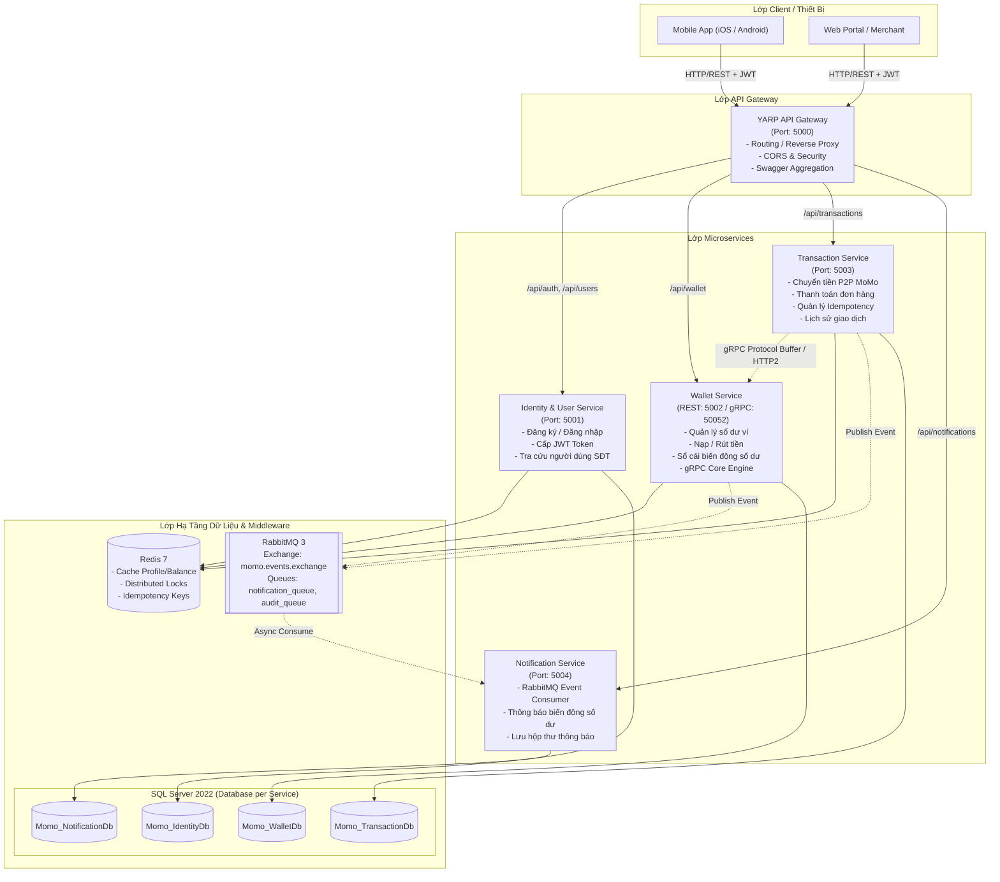
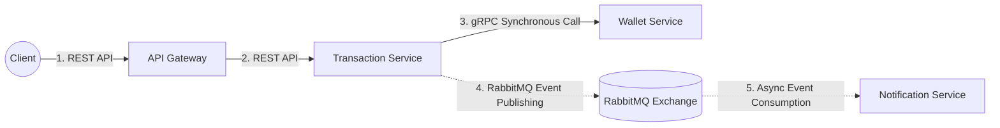
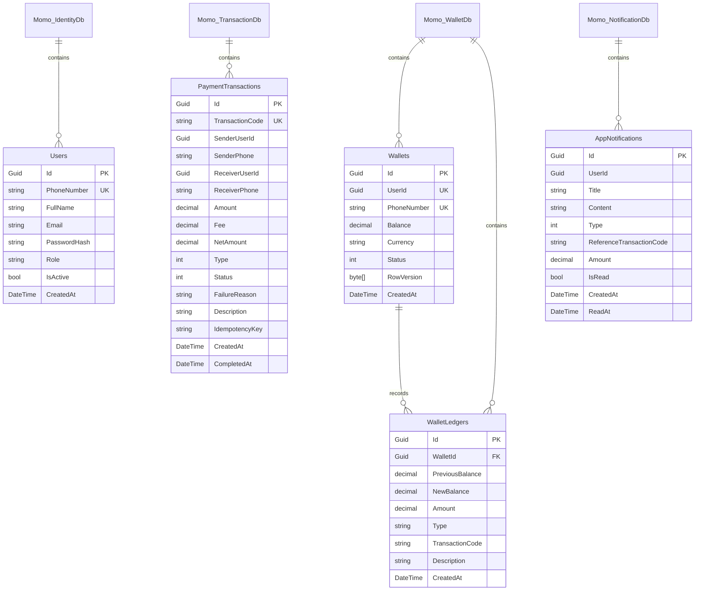

# Kiến Trúc Hệ Thống Ví Điện Tử MoMo (Microservices Architecture)

## 1. Tổng Quan Kiến Trúc (Architectural Overview)

Hệ thống thanh toán ví điện tử MoMo được thiết kế dựa trên kiến trúc **Microservices (Kiến trúc vi dịch vụ)** kết hợp mô hình **Event-Driven Architecture (EDA)** và **Remote Procedure Call (gRPC)** nhằm đáp ứng các tiêu chuẩn cao nhất về:
- **Tính độc lập (Decoupling):** Mỗi microservice phụ trách một domain nghiệp vụ duy nhất, sở hữu cơ sở dữ liệu riêng (Database-per-Service pattern).
- **Tính chịu tải và độ trễ thấp (High Throughput & Low Latency):** Sử dụng gRPC cho các giao dịch nội bộ đồng bộ thời gian thực và Redis Caching cho các truy vấn đọc.
- **Tính nhất quán dữ liệu & Chống double spending (Concurrency & Idempotency):** Áp dụng Redis Distributed Lock để serialize việc cập nhật số dư ví, chống race conditions, và Idempotency Key chống click đúp / retry trùng lặp.
- **Khả năng mở rộng bất đồng bộ (Asynchronous Scalability):** Sử dụng RabbitMQ Message Broker để xử lý các tác vụ như gửi thông báo biến động số dư, ghi log kiểm toán mà không làm chậm luồng giao dịch chính của khách hàng.

---

## 2. Sơ Đồ Kiến Trúc Tổng Thể (System Architecture Diagram)



---

## 3. Danh Mục Các Microservices & Trách Nhiệm (Service Catalog)

| Dịch vụ | Giao thức | Công nghệ chính | Cơ sở dữ liệu | Chức năng chính |
| :--- | :--- | :--- | :--- | :--- |
| **API Gateway** | REST (HTTP/1.1) | YARP, ASP.NET Core | Không lưu DB | Tiếp nhận request từ client, định tuyến an toàn, CORS, tổng hợp OpenAPI/Swagger. |
| **Identity Service** | REST | EF Core, JWT Bearer | `Momo_IdentityDb` | Đăng ký tài khoản bằng SĐT, đăng nhập cấp JWT, mã hóa mật khẩu PBKDF2/SHA256, tra cứu thông tin người nhận theo SĐT. |
| **Wallet Service** | REST & gRPC (HTTP/2) | EF Core, StackExchange.Redis, RabbitMQ | `Momo_WalletDb` | Quản lý số dư tiền VND, nạp tiền (Deposit), rút tiền (Withdraw), ghi sổ cái (Ledger), cung cấp gRPC Server chuyển tiền nội bộ. |
| **Transaction Service** | REST & gRPC Client | EF Core, Grpc.Net.Client, Redis, RabbitMQ | `Momo_TransactionDb` | Khởi tạo giao dịch chuyển tiền MoMo sang MoMo, thanh toán hóa đơn/đơn hàng, kiểm tra Idempotency Key, gọi gRPC sang Wallet Service, bắn event sang RabbitMQ. |
| **Notification Service** | REST & RabbitMQ Consumer | EF Core, RabbitMQ.Client, Background Worker | `Momo_NotificationDb` | Lắng nghe `TransactionCompletedEvent` và `WalletBalanceChangedEvent` qua RabbitMQ, tạo thông báo biến động số dư hộp thư người dùng. |

---

## 4. Chiến Lược Giao Tiếp Giữa Các Dịch Vụ (Inter-Service Communication)

Hệ thống kết hợp hài hòa 3 hình thức giao tiếp:



### 4.1. Đồng bộ mức cao (Synchronous Core Engine) bằng gRPC
- Khi Client yêu cầu chuyển tiền hoặc thanh toán, `Transaction Service` cần phải xác minh và trừ/cộng tiền ngay lập tức tại `Wallet Service`.
- **Tại sao dùng gRPC thay vì REST?**
  - **Hiệu năng:** gRPC chạy trên HTTP/2, dữ liệu serialize dạng nhị phân (Protocol Buffers) nhỏ gọn gấp nhiều lần so với JSON.
  - **Multiplexing:** Cho phép gửi đồng thời hàng ngàn request trên một kết nối TCP duy nhất mà không bị Head-of-Line blocking.
  - **Strict Contract:** File `wallet.proto` định nghĩa tường minh interface, kiểu dữ liệu, tự động sinh mã nguồn typed an toàn ở cả 2 đầu.

### 4.2. Bất đồng bộ mở rộng (Asynchronous Event-Driven) bằng RabbitMQ
- Sau khi giao dịch trừ/cộng tiền hoàn tất thành công, các tác vụ phụ trợ (như: Push notification cho người nhận, SMS/Email biến động số dư, ghi log phân tích hành vi người dùng) **tuyệt đối không được làm nghẽn tiến trình chuyển tiền của khách hàng**.
- `Transaction Service` chỉ việc publish một `TransactionCompletedEvent` lên `momo.events.exchange`.
- `Notification Service` chạy worker ngầm (`BackgroundService`) lắng nghe queue và xử lý không đồng bộ. Nếu Notification Service tạm thời downtime, tin nhắn vẫn được lưu an toàn trong hàng đợi RabbitMQ mà không bị mất.

---

## 5. Cơ Chế Chống Race Condition & Double Spending (Concurrency & Idempotency)

Thách thức lớn nhất của các ứng dụng tài chính như MoMo là:
1. Hai giao dịch cùng tác động vào số dư của 1 ví cùng một tích tắc (Race condition).
2. Người dùng bấm nút "Chuyển tiền" 2 lần liên tiếp do lag mạng (Double request).
3. Deadlock xảy ra khi Người A chuyển cho B cùng lúc Người B chuyển cho A.

### 5.1. Khóa phân tán đa tài nguyên chống Deadlock (Ordered Distributed Lock)
Trong `RedisDistributedLockService`:
- Khi thực hiện chuyển tiền từ Ví A sang Ví B, hệ thống cần khóa cả Ví A và Ví B.
- **Giải pháp chống Deadlock:** Sắp xếp danh sách khóa theo thứ tự bảng chữ cái (Deterministic Lexicographical Order):
  ```csharp
  var sortedKeys = resourceKeys.Distinct().OrderBy(k => k, StringComparer.Ordinal).ToList();
  ```
  Nhờ quy tắc này, dù A chuyển cho B hay B chuyển cho A thì tiến trình luôn tranh chấp lock khóa A trước rồi mới đến khóa B, loại bỏ hoàn toàn hiện tượng Deadlock vòng tròn (Circular Wait).

### 5.2. Cơ chế Idempotency Key (Chống trừ tiền 2 lần)
- Mọi request chuyển tiền và thanh toán đều cho phép gửi kèm header `X-Idempotency-Key` (UUID sinh bởi Client).
- Trước khi thực thi, hệ thống dùng lệnh Redis `SETNX (Set if Not Exists)`:
  - Nếu key đã tồn tại: Hệ thống phát hiện đây là request trùng lặp và trả về kết quả của giao dịch trước đó ngay lập tức (hoặc báo `DUPLICATE_TRANSACTION`).
  - Nếu key chưa tồn tại: Cho phép xử lý và ghi nhận kết quả lưu vào cache để phục vụ cho các lần gọi lại.

---

## 6. Mô Hình Cơ Sở Dữ Liệu (Database per Service)

Để đảm bảo tính tự chủ tuyệt đối (loose coupling), mỗi microservice quản lý database độc lập trên SQL Server:



---

## 7. Cơ Chế Bảo Mật & Xác Thực (Security & Authentication)

1. **JSON Web Token (JWT):**
   - Người dùng đăng nhập thành công nhận được JWT Token ký bằng thuật toán `HmacSha256`.
   - Token chứa `UserId`, `PhoneNumber`, `FullName`, `Role`.
   - Mọi API nhạy cảm (xem số dư ví, nạp/rút tiền, chuyển tiền) đều bắt buộc gửi kèm `Authorization: Bearer <token>`.
2. **Che giấu thông tin nhạy cảm (Data Masking):**
   - API tra cứu người nhận chỉ trả về số điện thoại đã được ẩn số giữa (`090****567`) và họ tên để người gửi xác nhận trước khi chuyển tiền.
3. **Mã hóa mật khẩu:** Sử dụng thuật toán PBKDF2 với muối ngẫu nhiên (Salt 16 bytes, Hash 32 bytes, 10,000 vòng lặp) an toàn trước các cuộc tấn công Rainbow Table.
4. **Cô lập mạng nội bộ (Network Isolation):**
   - Cổng gRPC 50052 chỉ mở kết nối trong mạng Docker nội bộ (`momo-network`), client từ bên ngoài internet chỉ có thể truy cập qua API Gateway (Port 5000).
