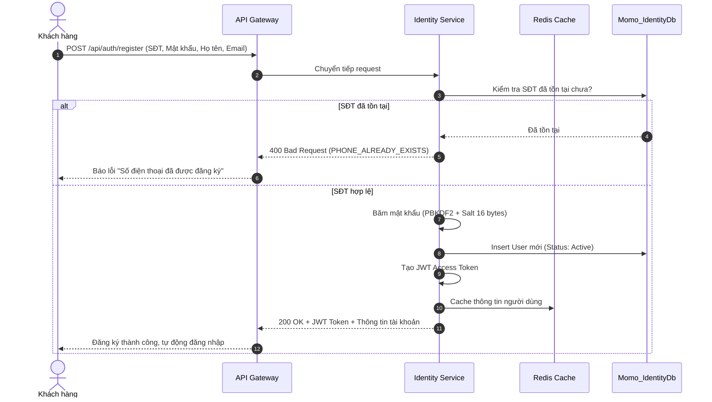
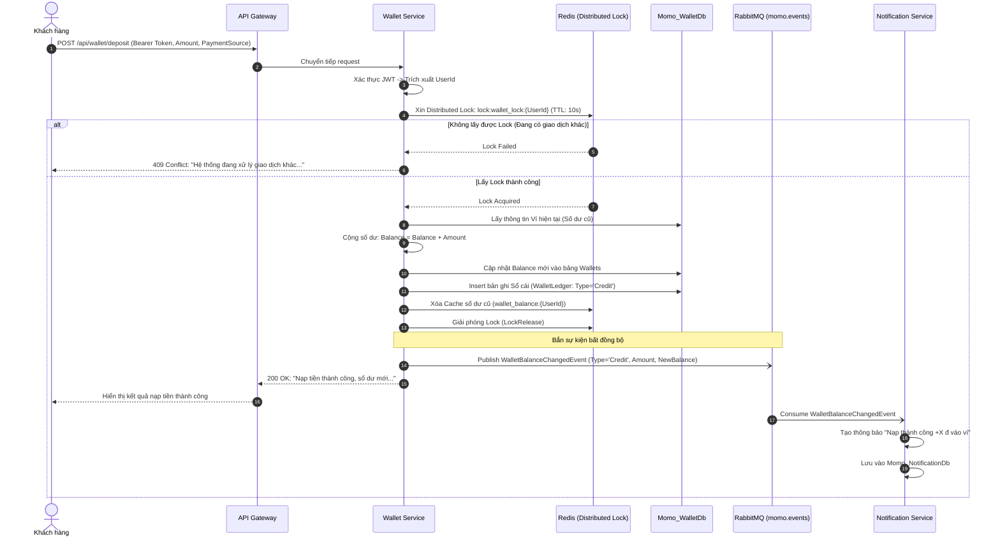
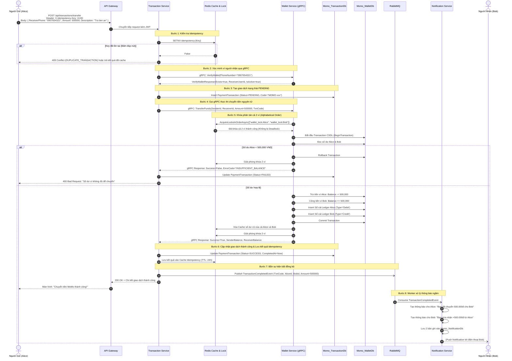
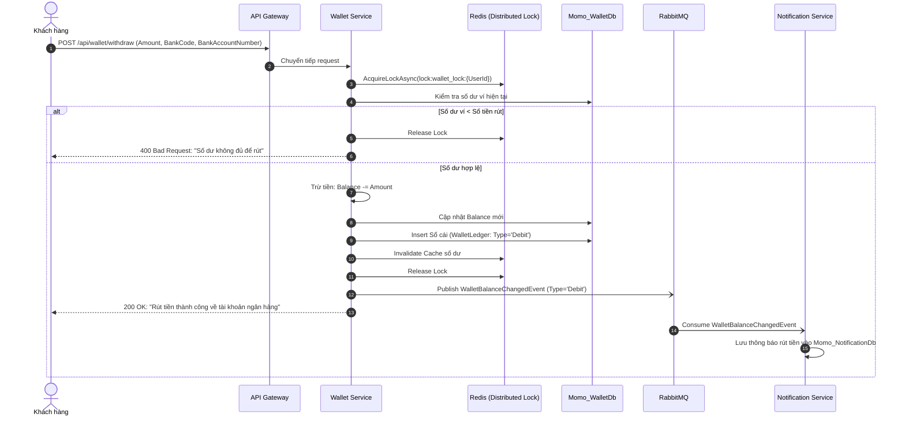
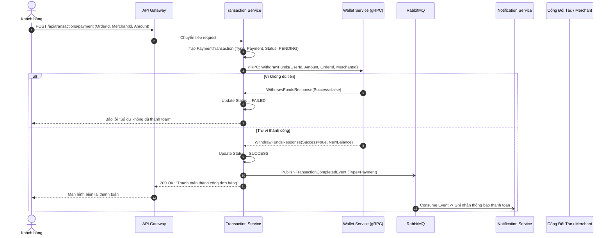
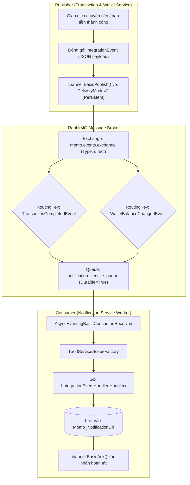

# Chi Tiết Các Luồng Nghiệp Vụ Ví MoMo (Business Flows)

Tài liệu này mô tả chi tiết các luồng nghiệp vụ (Workflow) của ứng dụng thanh toán MoMo bằng sơ đồ tuần tự (Sequence Diagram) và các bước xử lý từng giai đoạn.

---

## 1. Luồng Đăng Ký Tài Khoản & Khởi Tạo Ví (Registration Flow)

Khi một khách hàng mới đăng ký tài khoản MoMo, hệ thống thực hiện mã hóa mật khẩu, tạo bản ghi người dùng và tự động kích hoạt ví với số dư ban đầu là 0 VND.

---

## 2. Luồng Nạp Tiền Vào Ví MoMo (Deposit / Top-up Flow)

Khách hàng nạp tiền từ tài khoản/thẻ ngân hàng liên kết vào ví MoMo. Luồng này sử dụng **Redis Distributed Lock** để tránh xung đột cập nhật số dư và ghi nhận sổ cái biến động (Ledger).

---

## 3. Luồng Chuyển Tiền P2P MoMo Sang MoMo (P2P Money Transfer Flow)

Đây là luồng nghiệp vụ quan trọng nhất của MoMo: Khách hàng A chuyển tiền cho Khách hàng B qua Số Điện Thoại.
Luồng kết hợp:
1. **Idempotency Protection** qua Redis.
2. **gRPC inter-service communication** giữa Transaction Service và Wallet Service.
3. **Deadlock-Free Distributed Lock** trên 2 ví theo thứ tự chữ cái.
4. **RabbitMQ Event-Driven** thông báo số dư cho cả người gửi và người nhận.

---

## 4. Luồng Rút Tiền Về Ngân Hàng (Withdrawal Flow)

Khách hàng rút tiền từ ví MoMo về tài khoản ngân hàng liên kết (VCB, Techcombank, MB, v.v.).

---

## 5. Luồng Thanh Toán Đơn Hàng / Dịch Vụ (Merchant Payment Flow)

Khách hàng thanh toán tiền điện, nước, hóa đơn Shopee, Tiki, Lazada, hoặc mua vé máy bay thông qua MoMo.

---

## 6. Luồng Xử Lý Bất Đồng Bộ Với RabbitMQ (Event-Driven Notification Architecture)

Đảm bảo độ khả dụng cao và tách biệt hoàn toàn luồng giao dịch thanh toán khỏi luồng thông báo:

